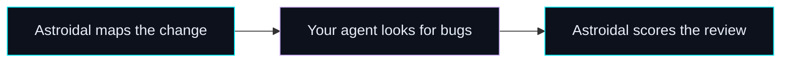

<div align="center">


# Astroidal

**Give your agent a map. Find what actually breaks.**

AI code review map, scorer, and helper. Astroidal draws the blast radius, steers your agent to real bugs, and scores the review into a clear verdict: **Passed**, **Review**, or **Fix first**.

[](https://www.npmjs.com/package/astroidal)
[](https://github.com/rizqirizqi/astroidal/actions/workflows/ci.yml)
[](LICENSE)
[](https://nodejs.org)

</div>

## How a review goes



## Start

Copy setup prompt for your agent:

```text
Set up Astroidal and review this change. Do not add it as a dependency. Run:

npx --yes astroidal init
npx --yes astroidal graph

Follow the installed Astroidal skill: search the bug map and write .astroidal/findings.json. Then run:

npx --yes astroidal rank

Reply with the score, Passed, Review, or Fix first, and the paths to .astroidal/review.md and .astroidal/constellation.html.
```

`init` installs the skill (default `.agents/skills/astroidal/`) and ignores `.astroidal/`. Pass `--agent cursor`, `--agent claude`, `--agent copilot`, or `--agent all` for other agent directories. `rank` exits 1 on Fix first; Passed and Review exit 0.

Command flags, exit codes, hosts (`gh` / `glab`), and the full output layout are in the [CLI README](packages/cli/README.md).

## Output

| File                            | What it is                    |
| ------------------------------- | ----------------------------- |
| `.astroidal/constellation.html` | The map and the score         |
| `.astroidal/packets/bug-map.md` | What the agent searches       |
| `.astroidal/review.md`          | Ranked findings, after `rank` |

## Scope

```bash
npx --yes astroidal graph --pr 12,18,24
npx --yes astroidal graph --open --label risk
npx --yes astroidal graph --stack
npx --yes astroidal graph --commit HEAD
npx --yes astroidal graph --staged
```

## Repository

| Path           | What it is                         |
| -------------- | ---------------------------------- |
| `packages/cli` | The published `astroidal` package  |
| `apps/site`    | The landing page, a Webstorio site |

```bash
npm test
npm run lint
npm run dev:site
```

## License

MIT.
